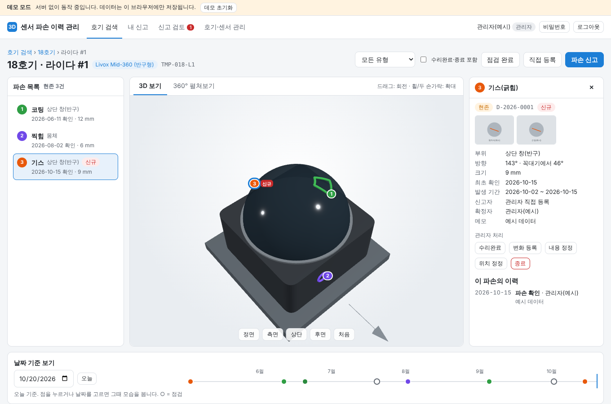
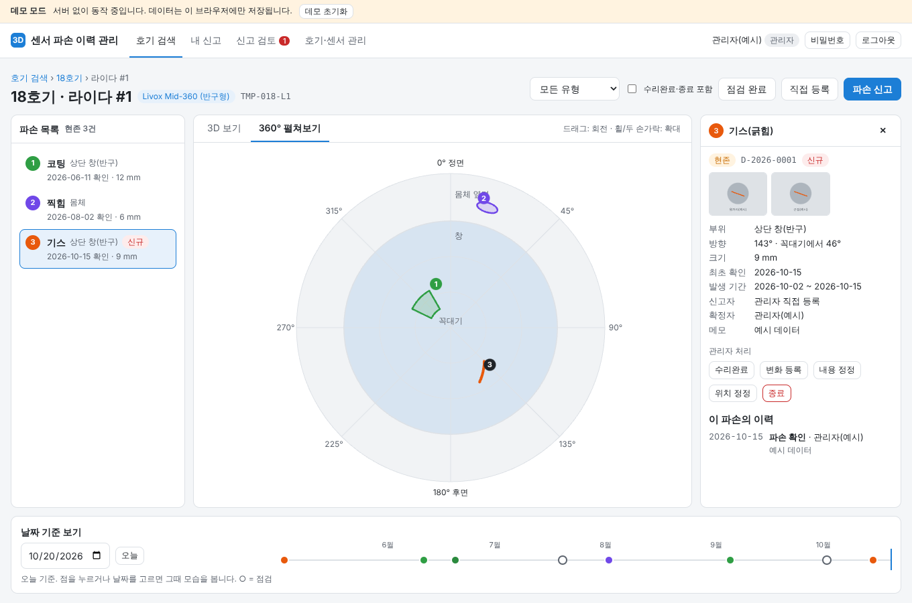
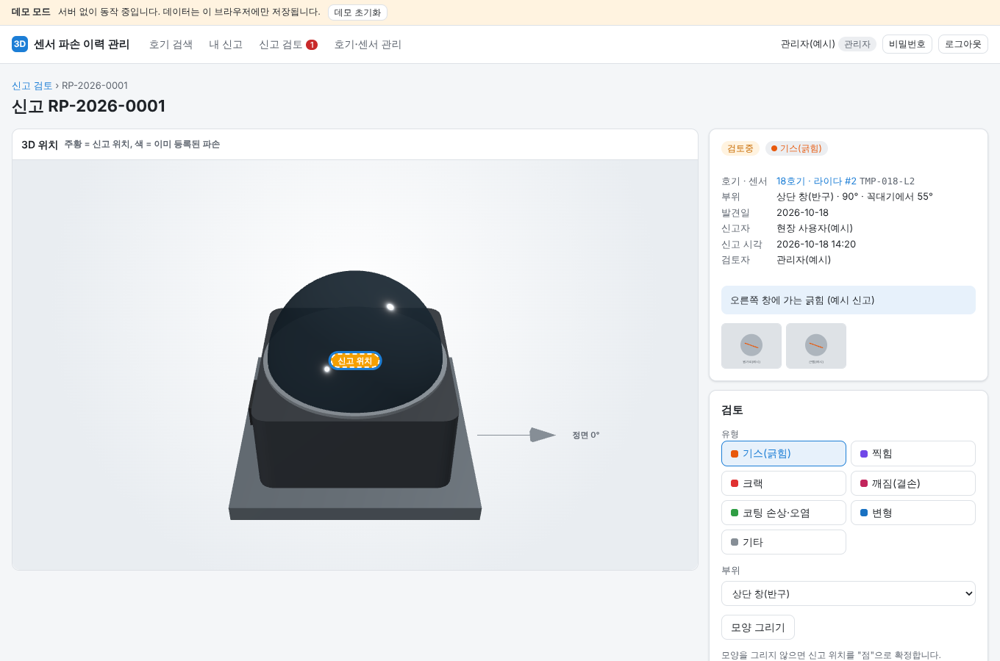
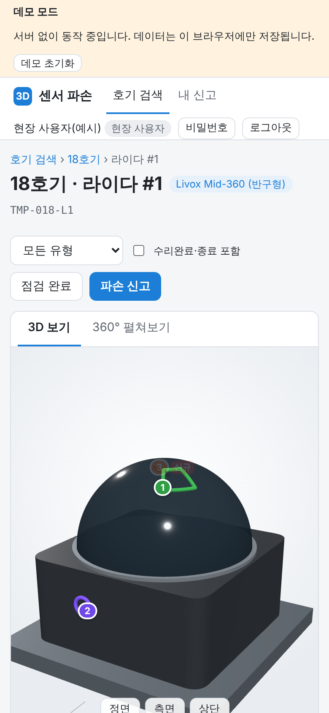

# 로봇 센서 파손 3D 이력관리

로봇 호기를 입력하면 라이다 2개·카메라 2개를 3D로 보여 주고, 센서마다 **어디에 · 어떤 파손이 · 언제부터** 있었는지를 이력으로 관리하는 웹 프로그램입니다.
현장 인원은 휴대폰 웹으로 파손을 신고하고, 관리자가 확인해 3D 위치를 확정하면 모두에게 공개됩니다.



## 주요 기능

| 기능 | 내용 |
| --- | --- |
| 호기 검색 | 번호 입력, 운영/폐기 필터, 로봇 QR 주소(`#/robot/18`)로 바로 열기 |
| 호기 상세 | 라이다 #1·#2, 카메라 #1·#2 카드(현존 파손·신규·검토 대기) |
| 3D 뷰어 | 360° 회전·확대·이동, 정면/좌측면/우측면/후면/상단 버튼(좌·우는 센서가 정면을 볼 때 기준), 파손 마커(유형별 색·번호), 누르면 사진·상세 |
| 360° 펼쳐보기 | 라이다 창을 평면으로 펼쳐 모든 방향의 파손을 한눈에. 원통형 = 띠, 반구형 = 위에서 본 원형 지도 |
| 날짜 기준 보기 | 날짜를 고르면 그날 있던 파손만, 그때 크기로 표시. 점검 기록으로 "발생 기간" 자동 계산 |
| 파손 신고(현장) | 3D에서 위치 누르기 → 유형 → 사진(휴대폰 카메라) → 제출. 5mm 안에 기존 파손이 있으면 같은 건지 물어봄 |
| 신고 검토(관리자) | 승인(새 파손 / 기존 파손에 합치기), 보완요청, 반려. 점·선·원·영역으로 모양 그리기 |
| 파손 처리(관리자) | 수리완료, 변화 등록, 내용·위치 정정, 종료, 되돌리기 — 모든 변경이 이력에 남음 |
| 호기·센서 관리 | 호기 등록(라이다 형상 자동), 폐기(센서별 폐기/예비 회수), 센서 교체, 시리얼·장착 각도 |
| 계정·변경 기록 | 개인별 계정, 역할(현장/관리자/시스템 관리자), 첫 로그인 비밀번호 변경, 감사 로그 |

| 360° 펼쳐보기(반구형) | 신고 검토 | 휴대폰 |
| --- | --- | --- |
|  |  |  |

기본 데이터: 1~30호기(1~5호기 폐기), **16호기까지 원통형 라이다, 17호기부터 반구형(Livox Mid-360)**, 카메라는 전 호기 **Intel RealSense D405**.

## 바로 써 보기 — 세 가지 방법

| 방법 | 필요한 것 | 데이터 저장 | 용도 |
| --- | --- | --- | --- |
| ① GitHub Pages | GitHub 저장소 | 보는 사람 브라우저에만(데모) | 화면·흐름 확인, 공유 |
| ② 내 PC 미리보기 | Node.js 22.13 이상 | 브라우저에만(데모) | 설치 없이 바로 확인 |
| ③ 서버 운영 | Node.js 22.13 이상 | 서버 DB(SQLite) + 사진 폴더 | 실제 신고·이력 관리 |

화면 코드는 하나입니다. 같은 주소에 서버(`/api/health`)가 있으면 서버 모드, 없으면 자동으로 데모 모드가 됩니다(`public/config.js`).

데모 계정: `field / field1234`(현장), `admin / admin1234`(관리자), `sysadmin / sys1234`(시스템 관리자). 예시 파손은 18호기 라이다 #1, 8호기 라이다 #1, 20호기 카메라 #1에 있습니다.

### ② 내 PC에서 바로 보기

```bash
npm run dev:static      # http://localhost:5173  (설치 필요 없음)
```

## GitHub에 올리기

```bash
cd robot-sensor-damage
git init
git add .
git commit -m "센서 파손 3D 이력관리 첫 버전"
git branch -M main
git remote add origin https://github.com/<계정>/robot-sensor-damage.git
git push -u origin main
```

GitHub Pages(①)로 데모를 띄우려면: 저장소 **Settings → Pages → Source = GitHub Actions**. 이후 `main`에 올릴 때마다 `.github/workflows/pages.yml`이 `public/` 폴더를 배포합니다. 주소는 `https://<계정>.github.io/robot-sensor-damage/` 입니다.

> 주의: GitHub Pages 사이트는 기본적으로 인터넷 공개입니다. 데모 모드라 서버에 데이터가 쌓이지는 않지만, 실제 현장 사진·고객 정보는 서버 모드(③)에서만 다루세요.

`.github/workflows/ci.yml`은 올릴 때마다 업무 로직 테스트(`npm test`)를 돌립니다.

## 서버에서 운영하기 (③)

필요: Linux 서버(또는 PC), **Node.js 22.13 이상**(내장 SQLite 사용 — 별도 DB 설치 없음).

```bash
git clone https://github.com/<계정>/robot-sensor-damage.git /srv/robot-sensor-damage
cd /srv/robot-sensor-damage
npm ci --omit=dev
cp .env.example .env          # 필요하면 수정
npm start                     # http://localhost:3000
```

- 처음 실행하면 1~30호기 기본 데이터를 만들고 **시스템 관리자 임시 비밀번호를 화면에 출력**합니다(`sysadmin`). 첫 로그인 때 비밀번호를 바꾸게 됩니다.
- 예시 데이터까지 넣어 시험하려면 시작 전에 `npm run seed:demo` (실제 운영 전에는 `npm run seed -- --reset`으로 다시 시작).
- 현장 휴대폰에서 접속하려면 외부에서 열리는 주소와 **HTTPS**가 필요합니다. `deploy/nginx.conf.example`(Nginx + Let's Encrypt)을 참고하세요. 프록시 뒤에서는 `.env`에 `TRUST_PROXY=1`.
- 상시 실행: `deploy/robot-sensor-damage.service`(systemd) 또는 pm2.
- 업데이트: `./scripts/deploy.sh` (git pull → 의존성 설치 → 재시작)
- 백업: `./scripts/backup.sh` — DB와 사진을 `data/backups/`에 묶고 7개만 보관. 매일 cron 등록 권장.

### Docker (사내 서버로 옮길 때)

```bash
docker compose up -d          # 데이터는 ./data 에 남습니다
```

## 폴더 구조

```text
robot-sensor-damage/
├─ public/                    # 화면 파일 — GitHub Pages·Nginx가 그대로 내려줌
│  ├─ index.html
│  ├─ config.js               # 모드(auto/server/demo), GLB 모델 목록
│  ├─ css/app.css
│  ├─ js/
│  │  ├─ core/                # ★ 업무 로직 — 브라우저(데모)와 서버가 같은 코드를 씀
│  │  │  ├─ constants.js      #   라이다 형상 규칙, 파손 유형, 상태
│  │  │  ├─ sensorModels.js   #   센서 3종 치수·부위
│  │  │  ├─ service.js        #   신고·승인·이력·호기 관리 규칙
│  │  │  ├─ routes.js         #   REST 경로표(서버·화면 공용)
│  │  │  ├─ schema.js         #   테이블 정의
│  │  │  ├─ seed.js           #   1~30호기 초기 데이터
│  │  │  └─ geometry.js, memoryStore.js
│  │  ├─ api/                 # 서버 모드(remote) / 데모 모드(local, IndexedDB)
│  │  ├─ three/               # 3D 뷰어, 센서 모델, 360° 펼쳐보기
│  │  ├─ views/               # 화면별 코드
│  │  └─ ui/                  # 공통 UI(모달, 사진 고르기 등)
│  ├─ models/                 # (선택) 실제 CAD GLB 파일
│  └─ vendor/three/           # Three.js r170 (CDN 없이 사내망에서도 동작)
├─ server/                    # Node.js 서버 — Express + node:sqlite
│  ├─ app.js                  #   API·세션·사진·보안 헤더
│  ├─ store.js                #   SQLite 저장소
│  ├─ runtime.js, config.js, seed.js, backup.js, static-preview.js
├─ test/core.test.js          # 업무 로직 테스트
├─ deploy/                    # Nginx·systemd 예시
├─ scripts/                   # deploy.sh, backup.sh
├─ .github/workflows/         # Pages 배포, 테스트
├─ Dockerfile, docker-compose.yml, .env.example
└─ data/                      # (Git 제외) app.db, photos/, backups/
```

## 데이터와 규칙

- 파손은 **센서 실물(시리얼)**에 붙습니다. 센서를 예비로 회수해 다른 호기에 달아도 이력이 따라갑니다.
- 폐기·수리완료·종료는 모두 "상태 변경"이며 기록은 지워지지 않습니다. 영구 삭제는 잘못 등록한 호기에 한해 시스템 관리자만 할 수 있습니다.
- 초기 센서 시리얼은 `TMP-018-L1` 같은 임시 번호입니다. 호기 상세 → "시리얼·각도"에서 실제 번호로 바꾸세요.
- 3D 좌표는 mm, 원점 = 센서 중심, 위 = +Y, 정면 = +Z. 라이다 각도는 위에서 볼 때 정면에서 시계 방향이며, 장착 각도 보정을 넣으면 로봇 기준 각도로 보입니다.
- 사진은 올리기 전에 휴대폰에서 장변 1600px로 줄여 저장합니다(썸네일 360px 별도).
- 파손 등급(심각도)은 데이터 칸만 있고 화면은 아직 없습니다(관리자 판단으로 추후 추가).

## 실제 센서 모델(GLB)로 바꾸기

기본은 실제 치수로 그린 단순 모델입니다. 제조사 CAD를 GLB로 바꿔 `public/models/`에 넣고 `config.js`의 `glbModels`에 적으면 대신 쓰입니다. 방법은 [`public/models/README.md`](public/models/README.md)를 보세요.

## 알려진 한계 · 다음 단계

- 원통형 라이다 치수는 VLP-16급 가정치(Ø103 × 72 mm)입니다. 정확한 모델명을 확인하면 `sensorModels.js`에서 고치세요.
- 센서 4개가 로봇의 어느 자리에 달리는지(앞·뒤·좌·우) 그림은 아직 없습니다.
- 로봇 QR 코드 인쇄 화면, 두 시점 나란히 비교, 통계 대시보드, PDF 인수인계 리포트, 사내 SSO 로그인은 다음 단계입니다.
- 데모 모드 데이터는 그 브라우저에만 있고, "데모 초기화"로 지울 수 있습니다.
